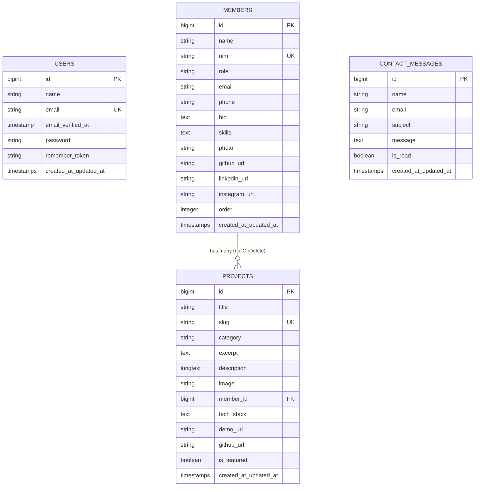

# Web Portofolio Terpadu Kelompok 05
> **Tugas Besar Mata Kuliah Pemrograman Web — Semester 5**  
> Aplikasi Web Portofolio Kolaboratif 4 Mahasiswa dengan Sistem Autentikasi dan Manajemen CRUD Lengkap Berbasis **Laravel 13**, **Tailwind CSS v4**, dan **MySQL**.

---

## 📌 Daftar Isi
1. [Tentang Proyek](#-tentang-proyek)
2. [Fitur-Fitur Utama](#-fitur-fitur-utama)
3. [Teknologi & Stack yang Digunakan](#-teknologi--stack-yang-digunakan)
4. [Arsitektur & Skema Database](#-arsitektur--skema-database)
5. [Prasyarat Sistem (Prerequisites)](#-prasyarat-sistem-prerequisites)
6. [Panduan Instalasi & Menjalankan Proyek](#-panduan-instalasi--menjalankan-proyek)
7. [Akun Pengujian (Kredensial Default)](#-akun-pengujian-kredensial-default)
8. [Daftar Rute & Endpoint Aplikasi](#-daftar-rute--endpoint-aplikasi)
9. [Struktur Direktori Proyek](#-struktur-direktori-proyek)
10. [Pengujian Otomatis (Automated Testing)](#-pengujian-otomatis-automated-testing)
11. [Identitas Anggota Kelompok 05](#-identitas-anggota-kelompok-05)

---

## 📖 Tentang Proyek

Aplikasi **Web Portofolio Terpadu Kelompok 05** adalah platform web modern yang dirancang untuk memamerkan profil, kompetensi teknis, serta rekam jejak karya digital dari 4 mahasiswa pengembang dalam mata kuliah Pemrograman Web Semester 5.

Selain berfungsi sebagai etalase karya publik (*Landing Page Showcase*) yang interaktif, aplikasi ini dilengkapi dengan area internal (*Dashboard Admin*) yang dilindungi oleh autentikasi sesi penuh untuk melakukan manajemen data (*Create, Read, Update, Delete*) secara mandiri terhadap anggota tim, katalog proyek, serta kotak pesan masuk (*Contact Feedback*).

Desain antarmuka mengusung konsep **Edgy Minimalist Tech Showcase** dengan palet monokrom gelap (*Dark Mode high-contrast*), tipografi teknis (*JetBrains Mono* & *Plus Jakarta Sans*), serta elemen interaktif mikro (*modal popup*, *instant category filtering*, *client-side image preview*).

---

## ✨ Fitur-Fitur Utama

### 1. Halaman Publik (Landing Page)
- **Hero & System Metric Strip**: Ringkasan data langsung dari database (total anggota tim, jumlah karya proyek terpublikasi, status engine PHP 8.5 & Laravel 13).
- **Profil 4 Anggota Tim Mahasiswa**: Kartu profil berisi NIM, peran spesifik, bio singkat, daftar keahlian, dan tombol *Modal Detail*.
- **Modal Profil Mahasiswa Interaktif**: Menampilkan data mendalam mengenai mahasiswa, tautan profil GitHub, LinkedIn, Instagram, serta kontak langsung.
- **Arsip Karya Portofolio & Instant Filter**: Menampilkan proyek berdasarkan kategori (*Web Application, RESTful API, UI/UX Design, E-Commerce, dll.*) secara *real-time* tanpa perlu memuat ulang halaman (*zero page-refresh*).
- **Modal Detail Karya**: Menampilkan tangkapan layar proyek, kategori, kontributor mahasiswa terkait, ringkasan dan deskripsi lengkap fitur, daftar *tech stack*, tombol menuju repositori GitHub dan tautan *Demo Live*.
- **Spesifikasi Standar Perkuliahan**: Dokumentasi transparansi batasan 4 mahasiswa, arsitektur MVC, CRUD, dan integritas kode.
- **Formulir Kontak Terhubung Database**: Pengunjung/dosen dapat mengirim pesan masukan secara langsung yang langsung tercatat ke dalam database `contact_messages`.

### 2. Autentikasi Pengguna & Keamanan
- **Sistem Login & Register Sesi**: Menggunakan sesi Laravel yang aman (`web` guard) dengan regenerasi session ID untuk mencegah serangan *Session Fixation*.
- **Proteksi CSRF**: Seluruh *form submission* (`POST`, `PUT`, `DELETE`, `PATCH`) dilindungi token `@csrf`.
- **Enkripsi Kata Sandi**: Memanfaatkan algoritma hashing **Bcrypt** berstandar industri dengan work-factor adaptif.
- **Validasi Formulir Ketat**: Pemeriksaan format email, keunikan data (`unique`), kecocokan konfirmasi password (`confirmed`), dan panjang karakter minimum.
- **Quick Autofill Demo**: Tombol satu-klik pada formulir login untuk mempermudah sesi presentasi atau evaluasi dosen.

### 3. Panel Dashboard Admin (Manajemen CRUD)
- **Ringkasan Statistik (Overview)**: Kartu metrik total anggota (maks. 4 orang), total proyek, pesan baru belum dibaca, dan status koneksi database MySQL.
- **Tabel Ringkasan Cepat**: Akses langsung ke data anggota dan portofolio terbaru dari satu layar.
- **CRUD Anggota Kelompok (`/dashboard/members`)**:
  - *Create*: Penambahan data anggota tim beserta upload foto profil resmi.
  - *Read*: Tabel anggota dengan pagination, filter pencarian instan (*search query* nama, NIM, role, skills), serta counter jumlah proyek.
  - *Update*: Pembaruan profil, urutan tampil (`order`), keahlian, dan penggantian foto profil lama secara otomatis.
  - *Delete*: Penghapusan anggota dengan pembersihan file gambar dari disk penyimpanan secara otomatis.
- **CRUD Portofolio Proyek (`/dashboard/projects`)**:
  - *Create*: Input judul proyek, slug otomatis, kategori, relasi kontributor anggota, tech stack, thumbnail gambar, link GitHub, link demo, dan switch proyek unggulan (*featured*).
  - *Read*: Tabel proyek dengan filter kategori *dropdown*, pencarian teks, dan status *featured*.
  - *Update*: Pengeditan seluruh metadata proyek dan penggantian thumbnail gambar.
  - *Delete*: Penghapusan proyek beserta file media pendukungnya.
- **Kotak Masuk & Manajemen Pesan (`/dashboard/messages`)**:
  - Melihat feedback dari dosen/pengunjung.
  - Filter pesan berdasarkan status (*Semua*, *Belum Dibaca*, *Sudah Dibaca*).
  - Fitur *Toggle Status* baca (`PATCH`) dan hapus pesan (`DELETE`).
- **Pengaturan Profil Admin (`/dashboard/profile`)**:
  - Pengubahan nama admin dan alamat email akun.
  - Pengubahan kata sandi baru dengan verifikasi wajib kata sandi saat ini (*current password protection*).

---

## 🛠 Teknologi & Stack yang Digunakan

| Komponen | Teknologi | Keterangan |
|---|---|---|
| **Backend Framework** | **Laravel 13.x** | Arsitektur MVC, Eloquent ORM, Routing, Blade Templating, Middleware |
| **Bahasa Pemrograman** | **PHP 8.5+** | Fitur modern: Constructor property promotion, Type declarations, Match expressions |
| **Database** | **MySQL 8.x / MariaDB** | Database relasional dengan Foreign Key Constraints dan Cascade/Null behaviors |
| **Frontend Styling** | **Tailwind CSS v4** | Modern utility-first CSS framework via `@tailwindcss/vite` |
| **Asset Bundler** | **Vite 8.x** | Lightning-fast build tool dan hot module replacement |
| **Tipografi & Ikon** | **Google Fonts** | *Plus Jakarta Sans* (Body/Heading) & *JetBrains Mono* (Technical Monospace) |
| **Unit & Feature Testing** | **Pest PHP** | Framework testing berbasis ekspresif dan terstruktur |
| **Code Styling** | **Laravel Pint** | Standardisasi format kode PHP PSR-12 |

---

## 🗄 Arsitektur & Skema Database

Aplikasi menggunakan 4 entitas tabel utama dalam relasi database:



### Penjelasan Relasi & Integritas:
- Relasi **One-to-Many** antara `members` dan `projects`: Satu anggota kelompok dapat memiliki banyak proyek karya.
- Pengaturan constraint `foreignId('member_id')->nullable()->constrained('members')->nullOnDelete()` menjamin bila suatu anggota dihapus, data proyek tetap aman tersimpan dengan status kontributor dialihkan menjadi kolaborasi tim.
- Index unik (`unique`) diterapkan pada `members.nim`, `projects.slug`, dan `users.email` untuk mencegah duplikasi data.

---

## 💻 Prasyarat Sistem (Prerequisites)

Pastikan lingkungan lokal Anda telah terinstal:
- **PHP** versi **>= 8.2** (Disarankan PHP 8.4 atau 8.5) dengan ekstensi: `pdo_mysql`, `mbstring`, `openssl`, `bcmath`, `curl`, `fileinfo`.
- **Composer** versi **>= 2.5**
- **Node.js** versi **>= 18.x** dan **NPM**
- **MySQL Database Server** (aktif di port default 3306)

---

## 🚀 Panduan Instalasi & Menjalankan Proyek

Ikuti langkah-langkah berikut untuk menjalankan aplikasi di komputer lokal:

### 1. Masuk ke Direktori Proyek
```bash
cd "porto-kelompok"
```

### 2. Konfigurasi File Environment (.env)
Salin berkas template environment:
```bash
cp .env.example .env
```
Buka file `.env` dan sesuaikan konfigurasi database Anda:
```env
DB_CONNECTION=mysql
DB_HOST=127.0.0.1
DB_PORT=3306
DB_DATABASE=porto_kelompok
DB_USERNAME=root
DB_PASSWORD=
```
> *Pastikan Anda telah membuat database kosong bernama `porto_kelompok` di MySQL (melalui phpMyAdmin, MySQL CLI, atau DBeaver).*

### 3. Install Dependensi PHP
```bash
composer install
```

### 4. Generate Kunci Aplikasi (App Key)
```bash
php artisan key:generate
```

### 5. Jalankan Migrasi & Seeder Database
Perintah berikut akan membuat seluruh skema tabel sekaligus mengisi data 4 anggota, 5 proyek portofolio, dan akun admin default:
```bash
php artisan migrate:fresh --seed
```

### 6. Hubungkan Symlink Storage Publik
Pastikan folder upload berkas terhubung ke folder publik:
```bash
php artisan storage:link
```

### 7. Install Dependensi Frontend & Kompilasi Aset
```bash
npm install
npm run build
```
*(Opsional untuk mode pengembangan aktif):*
```bash
npm run dev
```

### 8. Jalankan Server Lokal Laravel
```bash
php artisan serve
```
Buka peramban (browser) dan akses alamat:
```
http://127.0.0.1:8000
```

---

## 🔐 Akun Pengujian (Kredensial Default)

Data akun administrator telah disediakan otomatis melalui `DatabaseSeeder`:

| Parameter | Nilai Kredensial |
|---|---|
| **URL Login** | [http://127.0.0.1:8000/login](http://127.0.0.1:8000/login) |
| **Email** | `admin@kelompok.test` |
| **Password** | `password` |
| **Hak Akses** | Administrator Penuh (Kelola Anggota, Proyek, Pesan, Profil) |

> **Catatan Presentasi**: Pada form login, Anda dapat mengklik tombol **`[GUNAKAN]`** untuk mengisi email dan kata sandi demo secara instan.

---

## 🧭 Daftar Rute & Endpoint Aplikasi

Berikut ringkasan endpoint yang terdaftar dalam `routes/web.php`:

### Rute Publik
| Metode HTTP | URI | Nama Rute | Deskripsi |
|---|---|---|---|
| `GET` | `/` | `home` | Halaman landing page utama & showcase |
| `POST` | `/contact` | `contact.send` | Mengirim pesan kontak ke database |

### Rute Tamu (Guest Auth)
| Metode HTTP | URI | Nama Rute | Deskripsi |
|---|---|---|---|
| `GET` | `/login` | `login` | Formulir login admin |
| `POST` | `/login` | `login.post` | Memproses otentikasi sesi |
| `GET` | `/register` | `register` | Formulir pendaftaran akun baru |
| `POST` | `/register` | `register.post` | Memproses pendaftaran dan login otomatis |

### Rute Terproteksi (Dashboard & CRUD)
| Metode HTTP | URI | Nama Rute | Deskripsi |
|---|---|---|---|
| `POST` | `/logout` | `logout` | Mengakhiri sesi dan logout |
| `GET` | `/dashboard` | `dashboard.index` | Overview ringkasan statistik sistem |
| `GET` | `/dashboard/profile` | `dashboard.profile` | Halaman pengaturan profil admin |
| `PUT` | `/dashboard/profile` | `dashboard.profile.update` | Memperbarui nama, email, dan kata sandi |
| `GET` | `/dashboard/members` | `dashboard.members.index` | Daftar tabel anggota kelompok |
| `GET` | `/dashboard/members/create`| `dashboard.members.create` | Form tambah anggota tim baru |
| `POST` | `/dashboard/members` | `dashboard.members.store` | Simpan anggota baru ke database |
| `GET` | `/dashboard/members/{id}/edit` | `dashboard.members.edit` | Form edit data identitas anggota |
| `PUT` | `/dashboard/members/{id}` | `dashboard.members.update` | Perbarui data identitas anggota |
| `DELETE`| `/dashboard/members/{id}` | `dashboard.members.destroy`| Hapus anggota tim & berkas fotonya |
| `GET` | `/dashboard/projects` | `dashboard.projects.index` | Daftar tabel portofolio proyek |
| `GET` | `/dashboard/projects/create`| `dashboard.projects.create` | Form tambah proyek baru |
| `POST` | `/dashboard/projects` | `dashboard.projects.store` | Simpan proyek karya ke database |
| `GET` | `/dashboard/projects/{id}/edit`| `dashboard.projects.edit` | Form edit portofolio proyek |
| `PUT` | `/dashboard/projects/{id}` | `dashboard.projects.update` | Perbarui portofolio proyek |
| `DELETE`| `/dashboard/projects/{id}` | `dashboard.projects.destroy`| Hapus proyek & thumbnail gambar |
| `GET` | `/dashboard/messages` | `dashboard.messages.index` | Tinjauan kotak pesan feedback |
| `PATCH` | `/dashboard/messages/{id}/toggle`| `dashboard.messages.toggle`| Ubah status pesan dibaca/belum |
| `DELETE`| `/dashboard/messages/{id}` | `dashboard.messages.destroy`| Hapus rekaman pesan |

---

## 📂 Struktur Direktori Proyek

```plaintext
porto-kelompok/
├── app/
│   ├── Http/
│   │   └── Controllers/
│   │       ├── AuthController.php            # Otentikasi sesi (login, register, logout)
│   │       ├── ContactMessageController.php   # Manajemen pesan masuk
│   │       ├── DashboardController.php        # Statistik & profil admin
│   │       ├── HomeController.php             # Landing page & publik kontak
│   │       ├── MemberController.php           # CRUD anggota kelompok
│   │       └── ProjectController.php          # CRUD portofolio proyek
│   └── Models/
│       ├── ContactMessage.php                 # Entitas pesan feedback
│       ├── Member.php                         # Entitas anggota (appends, photo_url)
│       ├── Project.php                        # Entitas proyek (appends, image_url)
│       └── User.php                           # Entitas otentikasi admin
├── database/
│   ├── migrations/                            # Berkas skema tabel MySQL
│   └── seeders/
│       └── DatabaseSeeder.php                 # Pengisian data awal 4 anggota & 5 proyek
├── resources/
│   ├── css/
│   │   └── app.css                            # Styling Tailwind CSS v4 & theme
│   ├── js/
│   │   └── app.js                             # Skrip frontend utama
│   └── views/
│       ├── auth/                              # Blade login & register
│       ├── dashboard/                         # Blade panel admin & CRUD modul
│       │   ├── members/                       # Index, create, edit anggota
│       │   ├── projects/                      # Index, create, edit proyek
│       │   ├── messages/                      # Kotak pesan masuk
│       │   ├── index.blade.php                # Overview metrik
│       │   └── profile.blade.php              # Pengaturan akun
│       ├── layouts/                           # Master layout Blade
│       │   ├── app.blade.php                  # Layout halaman publik
│       │   ├── auth.blade.php                 # Layout autentikasi
│       │   └── dashboard.blade.php            # Layout panel admin
│       └── home.blade.php                     # Halaman landing page lengkap
├── routes/
│   └── web.php                                # Seluruh deklarasi rute web
└── tests/
    └── Feature/
        └── PortfolioSystemTest.php            # Suite pengujian otomatis Pest PHP
```

---

## 🧪 Pengujian Otomatis (Automated Testing)

Proyek ini telah dilengkapi dengan suite pengujian otomatis komprehensif menggunakan **Pest PHP** untuk menjamin fungsionalitas dan keandalan sistem:

Jalankan pengujian dengan perintah:
```bash
php artisan test
```

### Cakupan Skenario Pengujian:
1. `halaman utama menampilkan portofolio kelompok dan anggota`: Memastikan render publik dan query relasi berjalan tanpa error.
2. `pengunjung belum login dialihkan ke halaman login saat akses dashboard`: Memastikan keamanan middleware `auth`.
3. `pengguna dapat login dan mengakses dashboard`: Memastikan otentikasi kredensial pengguna.
4. `admin dapat melakukan operasi CRUD pada anggota kelompok`: Menguji siklus Create, Read, Update, Delete untuk anggota tim.
5. `admin dapat melakukan operasi CRUD pada portofolio proyek`: Menguji siklus CRUD untuk proyek dan validasi relasi.
6. `pengunjung dapat mengirim formulir pesan kontak`: Menguji penyimpanan feedback dari form publik.
7. `model member dan project mengikutsertakan atribut appends pada serialisasi json`: Menguji integritas data modal popup.
8. `admin tidak dapat mengubah password baru tanpa current_password yang valid`: Memastikan proteksi keamanan password saat ini.
9. `admin dapat memperbarui nama, email, dan kata sandi dengan current_password yang benar`: Menguji update profil sukses.
10. `validasi formulir kontak mendeteksi email tidak valid`: Menguji validasi sisi server.

---

## 👥 Identitas Anggota Kelompok 05

| No | Inisial | Nama Lengkap | NIM | Peran / Tanggung Jawab |
|:---:|:---:|---|:---:|---|
| **01** | `AF` | **Ahmad Fauzi** | `230101001` | **Ketua Kelompok & Fullstack Developer**<br>Arsitektur sistem, routing, integrasi backend Laravel & MySQL. |
| **02** | `SN` | **Siti Nurhaliza** | `230101002` | **Frontend Developer & UI/UX Designer**<br>Perancangan antarmuka, layout responsif Tailwind, desain komponen modal. |
| **03** | `BP` | **Budi Pratama** | `230101003` | **Backend & Database Engineer**<br>Struktur migrasi, relasi Eloquent ORM, validasi form, keamanan sesi. |
| **04** | `RA` | **Rina Anggraini** | `230101004` | **Quality Assurance & Documentation**<br>Pengujian fungsionalitas CRUD, Pest automated tests, dokumentasi teknis. |

---

<p align="center">
  <b>Portofolio Terpadu Kelompok 05 &bull; Mata Kuliah Pemrograman Web Semester 5</b><br>
  Dikembangkan dengan integritas kode tinggi dan siap dipresentasikan.
</p>
